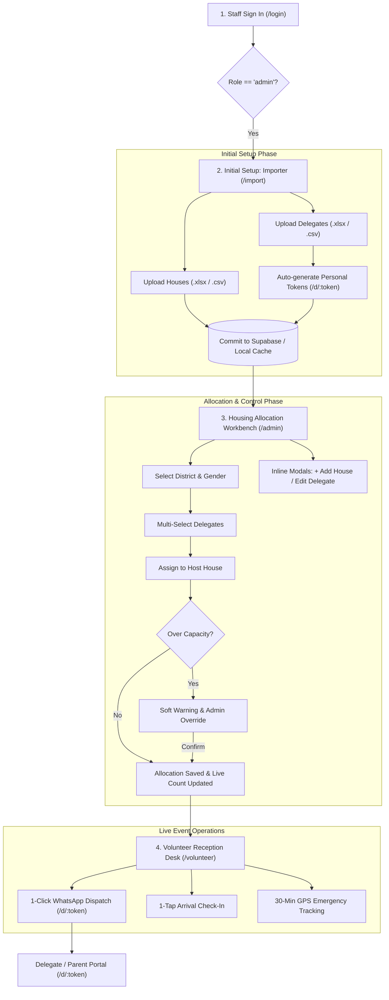
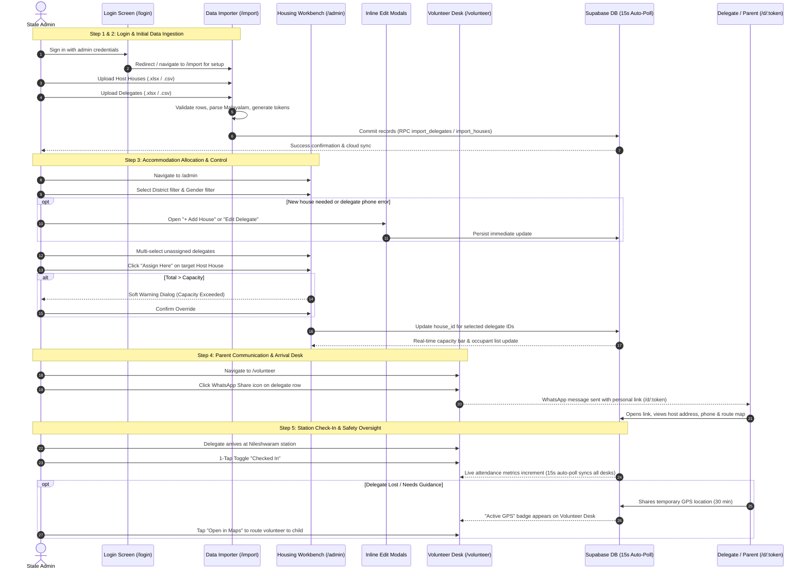

# Balasangham State Conference – Admin Features & User Flow
### ബാലസംഘം സംസ്ഥാന സമ്മേളനം – അഡ്മിൻ ഗൈഡ്

**Event:** 8th Balasangham State Conference (*നീലേശ്വരം, പാലായി, കാസർഗോഡ്*)  
**Dates:** November 27, 28, 29, 2026  
**Role:** **State Admin (Superadmin / സംസ്ഥാന അഡ്മിൻ)**  
**Target:** 500–700 Child Delegates (Aged 10–14), Coordinators, Host Homes & Volunteers  
**Scope:** Full Statewide Cross-District Authority, Initial Data Setup & Ingestion, Accommodation Allocation, Inline Editing & Creation, Real-Time Cloud Polling, Check-in Attendance Oversight & Child Safety Controls.

---

## 1. Overview of the Admin Role

In the Balasangham State Conference Accommodation & Stay Tracker, the **State Admin** represents the apex administrative authority (State Reception & Accommodation Committee). While District Coordinators are restricted to their specific home district and Volunteers are scoped strictly to their assigned child delegates, the **State Admin** holds complete cross-district governance, write privileges, and data management rights across all 14 Kerala districts.

### Role Permission Matrix

| Capability | State Admin | District Coordinator | Helpdesk Volunteer | Delegate / Parent |
| :--- | :---: | :---: | :---: | :---: |
| **All 14 Districts Visibility** | **Full (Statewide)** | Single District Only | Assigned Units | Own Stay Only |
| **CSV & Excel Spreadsheet Importer (`/import`)** | **Yes (.csv, .xlsx, .xls)** | No | No | No |
| **Assign / Reallocate Houses** | **Yes** | No (Read-Only) | No | No |
| **Add / Edit Host Houses from UI** | **Yes (`+ Add House` & Modal)** | No | No (Read-Only) | No |
| **Inline Edit Delegate Details** | **Yes (UI Modal)** | No (Read-Only) | Yes (Quick Phone Fix) | No |
| **Override House Capacity** | **Yes (Soft Warning)** | No | No | No |
| **Arrival Check-In Toggle** | **Yes** | Own District Only | Assigned Delegates | No |
| **View Host & Emergency Contacts** | **All Houses & Parents** | Own District | Assigned Delegates | Own Host & Volunteer |
| **Live GPS Location Pings** | **All Active (30m TTL)** | Own District | Assigned Delegates | Self-Share Only |
| **Auto Cloud Polling & Sync (15s)** | **Yes (Active)** | Yes (Active) | Yes (Active) | On Refresh |
| **Database Sync & Purge** | **Yes** | No | No | No |

---

## 2. Chronological Feature Breakdown & Modules

The platform is designed around a natural 4-stage operational journey for the State Admin:

```
[1. Sign In] ➔ [2. Initial Setup: /import] ➔ [3. Allocation & Control: /admin] ➔ [4. Dispatch & Reception: /volunteer]
```

---

### Step 1: Authentication & Role Recognition (`/login`)
- **Direct Authentication:** Secure sign-in using email and password powered by Supabase Auth (or interactive local mock storage fallback).
- **Default Admin Account:** `admin@balasangham.in` / `admin123`.
- **Dynamic Role Navigation:** Upon signing in as Admin, the top navigation automatically unlocks:
  - **Data Import (CSV / Excel)** (`/import`)
  - **Admin Workbench** (`/admin`)
  - **Volunteer Desk** (`/volunteer`)
- **Role Badge:** Top header displays the authenticated session status: `സംസ്ഥാന അഡ്മിൻ (State Admin)` with an active green pulse indicator.

---

### Step 2: Initial Setup — Data Ingestion & Onboarding (`/import`)

Immediately after logging in, the Admin's very first action is to populate the system with host houses and incoming child delegates. Without this initial setup, housing allocation cannot begin.

#### A. Multi-Format Spreadsheet Ingestion
- **Supported File Formats:** Ingests both **Microsoft Excel (`.xlsx`, `.xls`)** workbooks and standard **UTF-8 CSV (`.csv`)** files.
- **Malayalam Unicode & BOM Support:** Native support for Malayalam font encodings exported directly from Excel or Google Sheets without corrupted characters or broken glyphs.

#### B. The Two Ingestion Modules:
1. **Host Houses Import:**
   - **Required Columns:** `name`, `address`, `map_url`, `host_name`, `host_phone`, `capacity`, `gender_restriction`, `notes`.
   - Sets up the accommodation capacity matrix for Nileshwaram and Palayi.
2. **Delegates Import:**
   - **Required Columns:** `full_name`, `phone`, `district`, `gender`, `emergency_name`, `emergency_phone`, `notes`.
   - **Automatic Token Generation (FR-IMP-2):** Every child delegate is automatically assigned a cryptographically random, unguessable personal link token (*e.g., `kannur-arjun-412` or `del-9x8a21`*). This enables frictionless mobile access for children and parents without any password or app installation friction (`/d/:token`).

#### C. Validation & Commit Controls
- **Pre-Commit Preview Table:** Real-time parser validation checks for missing names, phone formatting, and valid district matching before committing.
- **Cloud & Local Synchronization:**
  - **"Sync Local to Cloud" Button:** Pushes staged local browser data to Supabase PostgreSQL in batched transactions.
  - **"Clear Local Cache" Button:** Clears device storage and reloads clean records directly from the database.

---

### Step 3: Housing Allocation & Control Workbench (`/admin`)

Once the initial data setup is committed at `/import`, the Admin proceeds to `/admin` to orchestrate room assignments, manage capacities, and make on-the-fly corrections.

#### A. Statewide Control Header & District Filter
- **14-District Selector:** Unlike District Coordinators whose district is locked, Admin has an active dropdown menu allowing instant switching between:
  - `All Districts (14 ജില്ലകൾ)` — statewide aggregate view.
  - Any single district (*e.g., Kannur, Kasaragod, Malappuram, Thiruvananthapuram, Kozhikode*).
- **Bilingual Interface:** Instant Malayalam (official **Anek Malayalam 800 Bold**) / English switcher.
- **Auto Cloud Polling (15s):** Automatically synchronises state with the central database every 15 seconds so multiple committee members see assignments in real time.

#### B. Live Metric Cards
Real-time summary counters dynamically updated upon every allocation or status toggle:
1. **Total Registered Delegates:** Aggregate count across all districts or filtered district.
2. **Accommodated Count:** Number of delegates currently assigned to a home + percentage completion progress indicator.
3. **Checked-In (ഹാജർ നില):** Real-time tally of child delegates who have reached the venue/station.
4. **Pending Arrival (വഴിയിലാണ്):** Delegates currently en route.

#### C. Left Pane: Unassigned Queue (`/admin`)
- Lists all delegates who currently do not have a room or host house assigned (`house_id === null`).
- **Real-Time Filters:**
  - **Search:** Instant substring filter across delegate names and phone numbers.
  - **Gender Filter:** 1-tap toggles for `All`, `Boys (ആൺകുട്ടികൾ)`, and `Girls (പെൺകുട്ടികൾ)`.
- **Multi-Select Batch Allocation:** Checkbox selection allowing the Admin to choose 1, 2, 4, or more delegates simultaneously for bulk assignment.
- **Delegate Meta Badges & Inline Edit:**
  - Displays district name, gender pill (Pink/Blue), phone number, and unit.
  - **Edit Pencil Icon (`Edit2`):** Clicking opens the **Edit Delegate Modal** to modify spelling, phone number, gender, district, or guardian emergency contacts on the fly.

#### D. Right Pane: Host Houses & Capacity Matrix (`/admin`)
- **Direct House Creation (`+ Add House`):** Admin can click the `+ Add House (വീട് ചേർക്കുക)` button to add a new host home directly from the UI without needing to re-upload a spreadsheet.
- **Inline House Editing:** Every house card features an **"Edit (തിരുത്തുക)"** button to update host contact numbers, capacity limits, gender restrictions, or navigation links in real time.
- **Capacity Progress Bar:**
  - Visual status bar showing occupants vs. maximum capacity (e.g., `3 / 4 persons`).
  - Color-coded badges: Green for `X slots free`, Amber for `Full (കപ്പാസിറ്റി പൂർത്തിയായി)`.
- **Gender Restriction Indicators:** Flags houses designated as `Girls Only (പെൺകുട്ടികൾക്ക് മാത്രം)` or `Boys Only (ആൺകുട്ടികൾക്ക് മാത്രം)`.
- **Bulk "Assign Here" Button:** Allots all currently selected delegates from the left pane into the target house with one tap.
- **Soft Over-Capacity Guard (FR-ASN-3):** If assigning exceeds the house's stated capacity, a confirmation modal alerts the Admin:
  > *"Warning: This house capacity is 4. Total will become 5. Do you wish to continue?"*  
  The Admin can confirm to deliberately override or cancel without saving.
- **Current Occupants Management:**
  - Shows an inline pill list of every child staying in that house.
  - **Inline Delegate Edit Icon:** Tap the pencil icon directly on an occupant pill to edit their details.
  - **1-Click Check-in Toggle:** Tap the check circle next to an occupant's name to toggle arrival status.
  - **1-Click Unassign Button (`X`):** Immediately removes a delegate from the house and places them back into the unassigned queue.

---

### Step 4: Inline Editing & House Creation Modals

To eliminate spreadsheet re-imports for minor corrections during live conference operations, full inline editing and creation is integrated into the UI.

#### A. Edit Delegate Modal (`EditDelegateModal.tsx`)
Accessible from the **Unassigned Queue**, **House Occupant Pills**, and the **Volunteer Desk**:
- **Full Name:** Update spelling or honorifics (*Malayalam or English*).
- **Phone Number:** Correct typing mistakes in delegate contact numbers.
- **Gender Toggle:** Switch between `Boy (ആൺകുട്ടി)` and `Girl (പെൺകുട്ടി)` with visual color-coded selectors.
- **District Re-assignment:** Move delegate to any of Kerala's 14 districts via a dropdown.
- **Guardian Emergency Details:** Dedicated amber-accented section to update parent/guardian name and phone number.
- **Unit & Special Notes:** Dietary requirements (vegetarian/non-vegetarian), unit name, or medical notes.
- **Real-Time Persistence:** Persists updates directly to Supabase (`delegates` table) and local cache with toast confirmation.

#### B. Add / Edit House Modal (`EditHouseModal.tsx`)
Accessible via the **"Add House"** header button and the **"Edit"** button on any house card:
- **House Name:** e.g., *പൂന്തോട്ടം വീട് (Poonthottam House)*.
- **Address:** Ward, municipality, street, and landmark details.
- **Host Contact:** Host name and primary mobile number.
- **Capacity / Beds:** Configurable number of occupants (1 to 100 beds).
- **Gender Restriction:** Set to `Any (ആൺ / പെൺ)`, `Boys Only (ആൺകുട്ടികൾ മാത്രം)`, or `Girls Only (പെൺകുട്ടികൾ മാത്രം)`.
- **Google Maps Route URL:** Direct Google Maps navigation link (`https://maps.google.com/?q=...`) for delegates and volunteers.
- **Landmark / Special Notes:** Walking distance from railway station, fan/water amenities, etc.

---

### Step 5: Reception Desk, WhatsApp Dispatch & Child Safety (`/volunteer`)

Once accommodation is assigned, the Admin monitors arrival operations and provides real-time emergency guidance:
- **Instant Lookup:** Search delegates by name, registration token, or phone number.
- **Status Filter:** View `All`, `Pending`, `Checked In`, or `With Live Location`.
- **Inline Delegate Edit:** Direct pencil edit button next to every delegate to fix phone numbers or guardian information during station reception.
- **1-Tap Attendance Check-In:** Instantly toggle delegate arrival state with floating toast notifications (`അർജുൻ കെ. - ഹാജർ രേഖപ്പെടുത്തി!`).
- **1-Click WhatsApp Dispatch (`wa.me`):** Pre-formats a WhatsApp message in Malayalam or English containing the child's direct stay link (`/d/:token`) to send to parents with one tap.
- **Host Directory Tab & Inline House Edit:** Switch to the "Houses" tab to view capacity utilisation, call hosts directly (`tel:`), view occupant lists, and click the edit icon to adjust house details.
- **Live GPS Emergency Tracking:** 
  - Polls active location pings submitted by delegates via their mobile browsers.
  - Enforces a strict 30-minute expiration window for child safety.
  - Provides a 1-tap **"Open in Google Maps"** navigation shortcut to locate lost delegates.

---

## 3. Visual Architecture & Navigation Flow



---

## 4. End-to-End User Flow for Admin



---

## 5. Step-by-Step Walkthrough of the Admin Workflow

### Phase 1: Sign In & Initial Setup at `/import` (Pre-Conference)
1. **Sign In (`/login`):** Enter admin credentials (`admin@balasangham.in` / `admin123`).
2. **Go to Data Import (`/import`):** Click **"Import CSV / Excel"** in the navigation header to perform the initial setup.
3. **Upload Host Houses:**
   - Select the **Houses** tab.
   - Upload the houses file (`.xlsx`, `.xls`, or `.csv`) containing host names, phone numbers, addresses, Google Maps URLs, and bed capacities.
   - Verify the pre-import table preview and click **"Commit Houses to Database"**.
4. **Upload Delegates:**
   - Select the **Delegates** tab.
   - Upload the delegates spreadsheet containing delegate names (*Malayalam/English*), district IDs, genders, and guardian phone numbers.
   - The platform automatically validates the rows and generates random tokens (*e.g., `kannur-arjun-412`*).
   - Click **"Commit Delegates to Database"**.
5. **Verify Cloud Synchronization:** Tap **"Sync Local to Cloud"** to ensure data redundancy on Supabase.

---

### Phase 2: Housing Allocation Matrix at `/admin` (Day -1 & Day 1)
1. **Open Workbench (`/admin`):** Navigate to `/admin` where all unassigned delegates and registered houses now appear.
2. **Add Extra Host Houses (If Needed):**
   - Click **"+ Add House (വീട് ചേർക്കുക)"** in the Houses pane header.
   - Enter house name, address, host phone, capacity, gender restriction, and Google Maps URL.
   - Click **"Create House"** to immediately make it available for allocation.
3. **Select Target District:** Use the top district selector to focus on incoming cohorts (*e.g., select "Kannur" to allocate the Kannur contingent*).
4. **Fix Typos On-the-Fly:** If a delegate's name, gender, or guardian contact number was entered incorrectly in the spreadsheet, tap the pencil icon next to their name to open the **Edit Delegate Modal**, update the field, and save.
5. **Filter by Gender:** Click **"Boys"** or **"Girls"** to match delegates with house policies.
6. **Select Delegates:** Check the boxes next to the delegates you wish to group together.
7. **Choose House:** Locate a house with sufficient free capacity in the right pane.
8. **Assign:** Tap **"Assign Here"**.
   - If capacity is sufficient: Instant allocation with an emerald success notification.
   - If over capacity: Confirm the soft warning dialog if you intentionally wish to add an extra occupant.
9. **Reallocate if Needed:** If travel plans change, locate the child under the house card and click the **`X`** unassign button to immediately return them to the queue.

---

### Phase 3: Reception Desk & Arrival Monitoring at `/volunteer` (Conference Days)
1. **Open Volunteer Desk (`/volunteer`):** Navigate to `/volunteer`.
2. **Search by Phone or Name:** As trains arrive at Nileshwaram Railway Station, search for arriving children or their accompanying coordinators.
3. **Correct Contact Info at the Gate:** If a child informs the desk of a new contact number or emergency parent number, click the inline edit pencil to update their profile instantly.
4. **Mark Attendance:** Tap the checkmark icon next to the delegate's record. The status updates to `Checked In`, timestamping the arrival.
5. **Dispatch Stay Links:** For parents who do not have their link handy, tap the green **WhatsApp** icon to launch a pre-populated message with their child's `/d/:token` link.
6. **Emergency GPS Assistance:** If a delegate is stranded or separated, instruct them to tap **"Share Location"** on their mobile portal. Their record on the Admin Volunteer Desk will highlight in green with an **"Open in Google Maps"** navigation button.
7. **Automated Multi-Device Sync:** The 15-second background cloud polling ensures all reception desks and committee phones remain continuously synchronised.

---

### Phase 4: Conference Conclusion & Child Data Privacy (Post-Event)
1. **Final Audit & Export:** Run a final export of check-in tallies and stay records for official Balasangham State Committee archives.
2. **Purge Runbook:** In accordance with child privacy policies (Section 9 of the Product Spec), the Admin can trigger a complete database wipe (`TRUNCATE` delegates, location pings, and emergency logs) to ensure no child personal contact data remains online.

---

## 6. Summary of Admin Best Practices

- **Initial Setup First:** Always complete spreadsheet uploads at `/import` before attempting allocation at `/admin`.
- **Instant Corrections:** Use the inline Edit Delegate Modal (`Edit2`) whenever a child or coordinator reports a phone number error rather than editing spreadsheets and re-importing.
- **Dynamic Host Registration:** When local community members offer additional rooms during the conference rush, use the `+ Add House` button to register them instantly.
- **Batch Operations:** Always filter by gender before multi-selecting unassigned delegates to prevent accidentally grouping mixed-gender cohorts into gender-restricted host homes.
- **Over-Capacity Policy:** The system allows soft over-capacity overrides to account for emergency accommodation scenarios (*e.g., extra sibling or guardian accompanying a delegate*), but always verify host consent before confirming.
- **Offline & Multi-Admin Sync:** With the 15-second automated background polling and local reactive caching, multiple admins working across different reception gates stay perfectly in sync without data collision.
