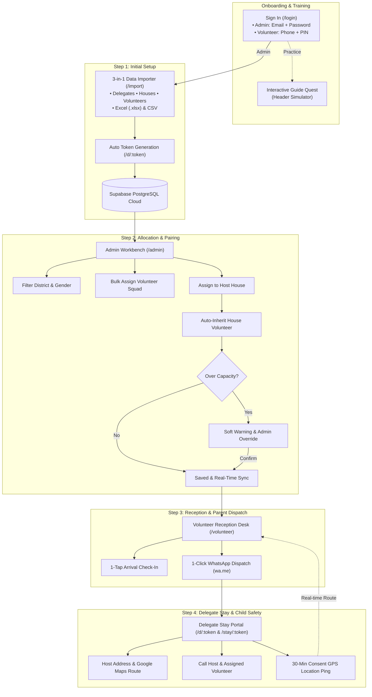
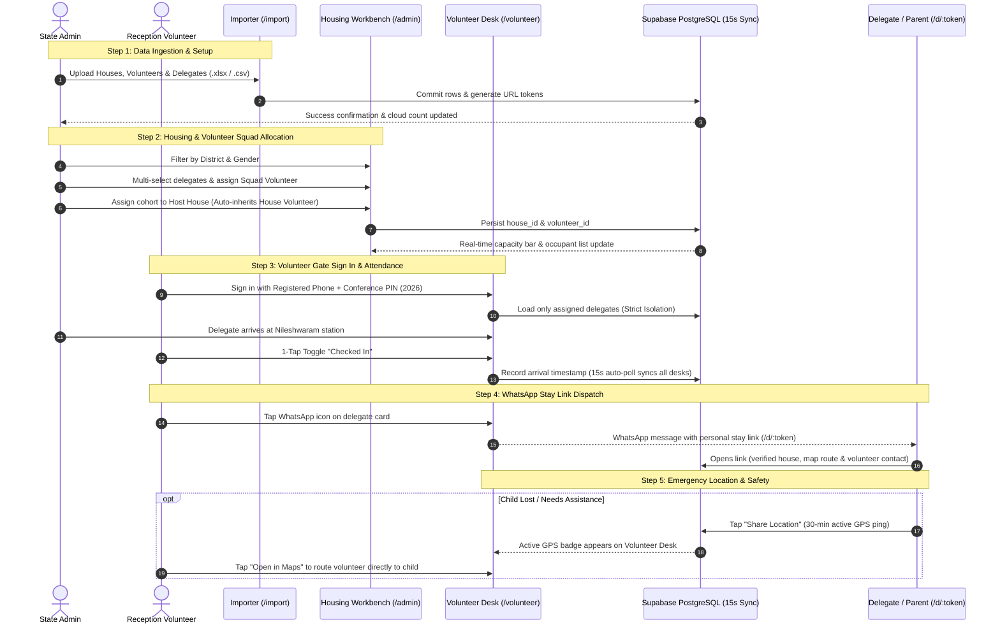

# Balasangham State Conference – Web App Features & Promotional Video Guide
### ബാലസംഘം സംസ്ഥാന സമ്മേളനം – താമസ വിവര പോർട്ടൽ: ഫീച്ചറുകളും പ്രമോഷണൽ വീഡിയോ സ്ക്രിപ്റ്റും

> **Event:** 8th Balasangham State Conference (*നീലേശ്വരം, പാലായി, കാസർഗോഡ്*)  
> **Dates:** November 27, 28, 29, 2026  
> **Audience:** State Administrators, District Coordinators, Reception Volunteers & Child Delegates  
> **Purpose:** Comprehensive feature reference & scene-by-scene script designed to produce a **Promotional "How-to-Use" Walkthrough Video** for reception committee members, volunteers, and parents.

---

## Part I: Promotional "How-to-Use" Video Script & Storyboard

* **Target Video Runtime:** ~3:30 to 4:00 minutes (or modular 30–60 second social media reels).  
* **Pacing:** Dynamic, inspiring, professional, and clear.  
* **Audio Track:** Energetic, uplifting background score (ducked during voiceover).  
* **Bilingual Visuals:** Malayalam UI on screen with English/Malayalam captions and bilingual voiceover cues.

---

### Scene 1: The Vision — Welcome to Nileshwaram (0:00 – 0:30)

| Visual Direction (On-Screen Action) | On-Screen Graphic / Text | Voiceover Narration (English & Malayalam) |
| :--- | :--- | :--- |
| **Wide cinematic establishing shot** of the conference artwork and logo. Fade into the web app landing page (`/`) on both mobile and desktop. Smooth scroll over the Nileshwaram Palayi banner and the bilingual switcher (`മലയാളം` / `English`). | **8-ാമത് ബാലസംഘം സംസ്ഥാന സമ്മേളനം** നീലേശ്വരം, പാലായി • 2026 നവംബർ 27–29 *600+ കുട്ടികളുടെ സുരക്ഷിത താമസം വിരൽത്തുമ്പിൽ!* | *"നവംബർ 27 മുതൽ 29 വരെ കാസർഗോഡ് നീലേശ്വരത്ത് നടക്കുന്ന 8-ാമത് ബാലസംഘം സംസ്ഥാന സമ്മേളനത്തിലേക്ക് എത്തുന്ന 600-ലധികം ബാലപ്രതിനിധികൾക്കായി അത്യാധുനിക താമസ വിവര പോർട്ടൽ സജ്ജമായിക്കഴിഞ്ഞു.*  Welcome to the official Balasangham State Conference Stay & Accommodation Platform—designed for frictionless reception, zero password hurdles, and 100% child safety." |
| Close-up on the hero search bar and 24/7 helpline cards: Control Room Desk, Medical Emergency, and Volunteer Dispatch. | **Zero Passwords • 100% Child Safety • Instant Offline Access** | *"യാത്രയിലുടനീളം വിവരങ്ങൾ ലഭ്യമാക്കാൻ ലോഗിൻ ആവശ്യമില്ലാത്ത വ്യക്തിഗത ലിങ്കുകൾ, 24 മണിക്കൂർ കൺട്രോൾ റൂം ഹെൽപ്പ്‌ലൈനുകൾ, പൂർണ്ണ ഓഫ്‌ലൈൻ സൗകര്യം എന്നിവ ഈ പ്ലാറ്റ്‌ഫോമിന്റെ സവിശേഷതയാണ്."* |

---

### Scene 2: Role-Based Sign In & Interactive Training Quest (0:30 – 1:00)

| Visual Direction (On-Screen Action) | On-Screen Graphic / Text | Voiceover Narration (English & Malayalam) |
| :--- | :--- | :--- |
| Click **"Sign In (ലോഗിൻ)"** from the header or landing card (`/login`). Show the smart **Tabbed Login Interface**:  1. **Volunteer Tab (Phone + PIN)** 2. **Admin Tab (Email + Password)**. | **Smart Tabbed Sign-In** • Volunteers: Mobile Number + Conference PIN • Admins: Official Email & Password | *"സംഘാടകർക്കും വളണ്ടിയർമാർക്കും പ്രവേശിക്കാൻ ലളിതമായ രണ്ട് ലോഗിൻ രീതികൾ. ഗ്രൗണ്ട് വളണ്ടിയർമാർക്ക് അവരുടെ രജിസ്റ്റർ ചെയ്ത മൊബൈൽ നമ്പറും സമ്മേളന പിൻ നമ്പറും (Conference PIN) മാത്രം മതി.*  Ground volunteers sign in in seconds with just their phone number and PIN—no forgotten password delays at the railway station." |
| Switch to Admin tab, fill `admin@balasangham.in`, tap Sign In. Camera zooms into the header to reveal the amber **"How to Use / ഗൈഡ്"** Quest button. | **Interactive Guide Quest** *എങ്ങനെ ഉപയോഗിക്കാം? (5-Step Training Simulator)* | *"ആദ്യമായി ഉപയോഗിക്കുന്നവരാണോ? ഹെഡറിലെ 'How to Use' ഗൈഡ് വഴി യഥാർത്ഥ ഡാറ്റയെ ബാധിക്കാതെ സിമുലേറ്ററിലൂടെ 5 സ്റ്റെപ്പുകളിൽ കാര്യങ്ങൾ പരിശീലിക്കാം!"*  Before managing live delegates, organizers can launch the built-in Interactive Quest to master the entire system in a zero-risk simulator." |

---

### Scene 3: Initial Setup — 3-in-1 Data Importer (`/import`) (1:00 – 1:40)

| Visual Direction (On-Screen Action) | On-Screen Graphic / Text | Voiceover Narration (English & Malayalam) |
| :--- | :--- | :--- |
| Navigate to `/import`. Highlight the 3 unified module tabs: **Delegates**, **Host Houses**, and **Volunteers**. Show drag-and-drop of an Excel (`.xlsx`) or CSV file. | **Multi-Format 3-in-1 Importer** • Delegates • Host Houses • Volunteers • Excel (.xlsx, .xls) & UTF-8 CSV | *"സമ്മേളന ഒരുക്കങ്ങളുടെ ആദ്യ പടി ഡാറ്റ അപ്‌ലോഡ് ചെയ്യലാണ്. എക്സൽ, സിഎസ്വി ഫയലുകൾ നേരിട്ട് ഇമ്പോർട്ട് ചെയ്യാം. മലയാളം പേരുകൾ കൃത്യമായി സപ്പോർട്ട് ചെയ്യുന്ന യൂണികോഡ് എഞ്ചിൻ ഇതിലുണ്ട്."*  The Admin setup begins at the Importer. Upload delegate lists, host residences, and volunteers in Excel or CSV format with native Malayalam Unicode support." |
| Show instant pre-commit validation preview. Point out that delegates get **auto-generated random tokens** (*e.g., `kannur-arjun-412`*). Show natural key deduplication badge (`Clean & Unique`). | **Auto Token Generation (FR-IMP-2)** • Unguessable Personal Stay URLs • Smart Natural Key Deduplication | *"ഓരോ കുട്ടിക്കും പാസ്‌വേഡില്ലാതെ തുറക്കാവുന്ന യുണീക്ക് ടോക്കണുകൾ ഓട്ടോമാറ്റിക്കായി ജനറേറ്റ് ചെയ്യപ്പെടുന്നു. വീടുകളുടെ വിവരങ്ങൾ ആവർത്തിക്കാതിരിക്കാൻ സ്മാർട്ട് ഡീഡ്യൂപ്ലിക്കേഷനും ഉറപ്പാക്കിയിരിക്കുന്നു."* |
| Tap **"Commit to Database"**, followed by the green success badge and real-time Supabase cloud synchronization counter. | **One-Click Cloud Sync** Instant PostgreSQL Sync | *"ഡാറ്റ പരിശോധിച്ച് ഒറ്റ ക്ലിക്കിൽ ക്ലൗഡ് ഡാറ്റാബേസിലേക്ക് സിങ്ക് ചെയ്യാം. ഇതോടെ താമസ അലോട്ട്മെന്റിനായി സിസ്റ്റം സജ്ജമായി!"* |

---

### Scene 4: Housing Allocation & Volunteer Squad Assignment (`/admin`) (1:40 – 2:30)

| Visual Direction (On-Screen Action) | On-Screen Graphic / Text | Voiceover Narration (English & Malayalam) |
| :--- | :--- | :--- |
| Navigate to `/admin`. Pan across the **Two-Pane Operational Workbench**:  • Left: Unassigned Delegate Queue • Right: Host Houses & Capacity Matrix. | **Two-Pane Housing Workbench** • 14 Districts Filter • Real-Time Metrics • Live Capacity Tracking | *"ഇതാണ് അഡ്മിൻ വർക്ക് ബെഞ്ച്. 14 ജില്ലകളിലെയും പ്രതിനിധികളെ ഒന്നിച്ച് കാണാനും ഓരോ ജില്ല തിരിച്ചെടുക്കാനും സാധിക്കും.*  The Admin Workbench provides a unified two-pane command center: unassigned delegates on the left, host houses on the right." |
| Filter by Gender: Click **"Girls (പെൺകുട്ടികൾ)"**. Check 3 delegates in the unassigned queue. | **Smart Batch Allotment** Multi-Select Delegates + Gender Filter | *"ആൺകുട്ടികൾ, പെൺകുട്ടികൾ എന്നിങ്ങനെ ഫിൽട്ടർ ചെയ്ത് ഒരുമിച്ച് താമസിക്കേണ്ട കുട്ടികളെ ഒരൊറ്റ ക്ലിക്കിൽ സെലക്ട് ചെയ്യാം."* |
| Show the new **`+ Assign Volunteer (+ വളണ്ടിയറെ നൽകുക)`** dropdown activating in the queue header. Select `രേഷ്മ പി.`. An indigo badge `👤 രേഷ്മ പി.` appears on each child's card. | **Direct Volunteer Squad Assignment** *കുട്ടികൾക്ക് വളണ്ടിയർ ഇൻ-ചാർജ്ജ്* | *"സെലക്ട് ചെയ്ത കുട്ടികൾക്ക് ഉത്തരവാദിയായ സ്ക്വാഡ് വളണ്ടിയറെ മുകളിലെ ഡ്രോപ്പ്ഡൗൺ വഴി ഒന്നിച്ച് ചുമതലപ്പെടുത്താം!"*  Instantly pair delegates with squad volunteers using the bulk volunteer assignment tool." |
| On the right pane, locate *സൗപർണിക (Souparnika House)* with 3 slots free. Point out the **House Volunteer In-Charge** dropdown and tap **"Assign Here"**. The capacity bar smoothly animates to 100%. | **Auto-Inheritance & Capacity Guards** • Auto-assigned House Volunteer • Soft Over-Capacity Warning Override | *"വീടിന്റെ കപ്പാസിറ്റി ബാർ തത്സമയം അപ്ഡേറ്റാകുന്നു. വീടിന് നിശ്ചയിച്ച വളണ്ടിയറെ കുട്ടികൾക്ക് സ്വമേധയാ ലഭിക്കും. കപ്പാസിറ്റി കവിയുന്നുവെങ്കിൽ കൃത്യമായ വാണിംഗ് അലേർട്ടും ലഭിക്കും."*  Delegates allotted to a house automatically inherit that home's in-charge volunteer, while soft warnings prevent accidental overcrowding." |
| Highlight the **`+ Add House (വീട് ചേർക്കുക)`** button and the **Edit (`Edit2`)** pencil on delegate pills. Click Edit to show updating guardian phone and volunteer on the fly. | **Inline Creation & Live Editing** • + Add House on the fly • EditDelegateModal without re-importing | *"പുതിയ വീടുകൾ ചേർക്കാനോ ഫോൺ നമ്പറുകൾ തിരുത്താനോ സ്പ്രെഡ്ഷീറ്റ് വീണ്ടും അപ്‌ലോഡ് ചെയ്യേണ്ടതില്ല; വർക്ക് ബെഞ്ചിൽ നിന്ന് തന്നെ നേരിട്ട് തിരുത്താം."* |

---

### Scene 5: Reception Gate & WhatsApp Stay Dispatch (`/volunteer`) (2:30 – 3:15)

| Visual Direction (On-Screen Action) | On-Screen Graphic / Text | Voiceover Narration (English & Malayalam) |
| :--- | :--- | :--- |
| Transition to the **Volunteer Helpdesk (`/volunteer`)**. Show a train arriving at Nileshwaram station. The volunteer searches for a delegate by name or phone. | **Volunteer Helpdesk** • Instant Search • 1-Tap Attendance Check-In • Strict Volunteer Privacy Scope | *"ട്രെയിനുകൾ നീലേശ്വരം റെയിൽവേ സ്റ്റേഷനിൽ എത്തുമ്പോൾ ഹെൽപ്പ് ഡെസ്ക് വളണ്ടിയർമാർക്ക് നിമിഷങ്ങൾക്കകം കുട്ടികളെ സ്വീകരിക്കാം.*  At the reception desk, search by name or phone, and tap the checkmark to record arrival instantly." |
| Tap the checkmark icon next to a child. A floating toast appears: `അർജുൻ കെ. - ഹാജർ രേഖപ്പെടുത്തി!`. Attendance tallies increment immediately. | **Live Attendance Metrics** 15-Second Background Cloud Sync | *"ഹാജർ നില ഉടൻ തന്നെ സംസ്ഥാന കൺട്രോൾ റൂമിലും വർക്ക് ബെഞ്ചിലും തത്സമയം പ്രതിഫലിക്കുന്നു."* |
| Click the green **WhatsApp (`Share2`)** button on the delegate card. Show the pre-populated WhatsApp message with the child's personal stay link (`wa.me/?text=...`) ready to send to parents. | **1-Click WhatsApp Dispatch** Personal Stay Link sent directly to Parents | *"രക്ഷിതാക്കൾക്ക് കുട്ടിയുടെ താമസ വിവരങ്ങളും ഗൂഗിൾ മാപ്പും അടങ്ങിയ പേഴ്സണൽ ലിങ്ക് വാട്ട്സ്ആപ്പിലൂടെ ഒറ്റ ക്ലിക്കിൽ അയച്ചു നൽകാം!"*  One tap dispatches a pre-formatted WhatsApp message directly to parents with their child's personal stay link." |
| Show the **"Host Houses"** tab on the Volunteer Desk with direct-dial `tel:` phone shortcuts to host families. | **Host House Directory** 1-Tap Phone Dialing to Hosts | *"താമസ കേന്ദ്രങ്ങളിലെ ആതിഥേയരെ ഫോണിൽ വിളിക്കാനും റൂട്ട് മാപ്പ് കാണാനും വളണ്ടിയർ ഡെസ്കിൽ സൗകര്യമുണ്ട്."* |

---

### Scene 6: Child Safety Portal, Live GPS & PWA Offline Engine (3:15 – 3:45)

| Visual Direction (On-Screen Action) | On-Screen Graphic / Text | Voiceover Narration (English & Malayalam) |
| :--- | :--- | :--- |
| Show a child/parent opening their personal link on mobile (`/d/kannur-arjun-412` or `/stay/kannur-arjun-412`). Display: host house card, volunteer in-charge phone, Google Maps button, and emergency hotlines. | **Delegate Stay Portal (/d/:token)** • Verified House Address & Map • Direct Dial Host & Volunteer In-Charge • 24/7 Control Room Helplines | *"കുട്ടികൾക്കോ രക്ഷിതാക്കൾക്കോ ലഭിച്ച ലിങ്ക് തുറന്നാൽ താമസിക്കുന്ന വീടിന്റെ പേര്, ലൊക്കേഷൻ, ഗൂഗിൾ മാപ്പ് റൂട്ട്, ചുമതലയുള്ള വളണ്ടിയറുടെ ഫോൺ നമ്പർ എന്നിവ കൃത്യമായി കാണാം."*  Delegates see verified stay info, their assigned volunteer's contact, Google Maps directions, and 24/7 helplines." |
| Simulate a child tapping **"Share Location"**. On the Admin Volunteer Desk, an animated green badge appears: `Active GPS (Live)`. The volunteer taps **"Open in Google Maps"** to navigate directly to the lost child. | **Consent-Based GPS Safety (FR-LOC-1)** • 30-Minute Safe Location Ping • 1-Tap Google Maps Routing | *"വഴി തെറ്റുകയോ സഹായം ആവശ്യമായി വരികയോ ചെയ്താൽ 'Share Location' ക്ലിക്ക് ചെയ്താൽ 30 മിനിറ്റ് നേരത്തേക്ക് വളണ്ടിയർമാർക്ക് കുട്ടിയുടെ ലൊക്കേഷൻ മാപ്പിൽ കാണാനും സഹായിക്കാനും കഴിയും."* |
| Simulate turning on Airplane Mode. Show the live **"ഓഫ്‍ലൈൻ മോഡ് (Offline Mode)"** banner appearing gracefully while cached stay cards remain 100% accessible. | **100% PWA Offline Ready** Works without Network during Train Journeys | *"നെറ്റ്‌വർക്ക് ഇല്ലാത്ത ട്രെയിൻ യാത്രയിലും വിവരങ്ങൾ ലഭ്യമാകുന്ന പൂർണ്ണ ഓഫ്‌ലൈൻ PWA സാങ്കേതികവിദ്യ!"* |

---

### Scene 7: Outro & Call to Action (3:45 – 4:00)

| Visual Direction (On-Screen Action) | On-Screen Graphic / Text | Voiceover Narration (English & Malayalam) |
| :--- | :--- | :--- |
| Split-screen showcasing the entire unified ecosystem: Admin Workbench, Volunteer Desk, and Mobile Delegate Portal. Balasangham State Conference organizing committee credentials and official portal URL fade in. | **ബാലസംഘം സംസ്ഥാന സമ്മേളനം** സ്വാഗതസംഘം ഓഫീസ് • നീലേശ്വരം, പാലായി *സുരക്ഷിതമായ താമസ സൗകര്യങ്ങളോടെ സമ്മേളനത്തിലേക്ക് സ്വാഗതം!* | *"8-ാമത് ബാലസംഘം സംസ്ഥാന സമ്മേളനത്തിലേക്ക് എല്ലാ പ്രിയ കൂട്ടുകാർക്കും ഹൃദ്യമായ സ്വാഗതം!*  Welcome to the 8th Balasangham State Conference. Technology powering seamless care for every child." |

---

## Part II: Complete Feature Specification & Admin Modules

This section details every feature implemented in the platform, linking operational workflows to technical capabilities.

### 1. Authentication & Role-Based Access Control (RBAC)

| User Role | Credentials / Auth Mechanism | Unlocked Pages & Privileges | Privacy & Security Isolation |
| :--- | :--- | :--- | :--- |
| **State Admin** | Official Email & Password (`admin@balasangham.in`) | Full access to `/admin`, `/import`, `/volunteer`, `/`, and management modals. | Unrestricted statewide read/write across all 14 Kerala districts. |
| **District Coordinator** | District Email & Password (`kannur@balasangham.in`) | Access to `/admin` and `/volunteer`. | Strictly locked to delegates of their assigned home district. |
| **Ground Volunteer** | **Registered Mobile Phone Number + Conference PIN** (`2026`) | Unlocks `/volunteer` (Volunteer Desk). | **Strict Scope Isolation:** Volunteers can ONLY see delegates and host houses specifically assigned to their care. |
| **Delegate / Parent** | **Zero Login!** Unguessable URL token (`/d/:token` & `/stay/:token`) | Public read-only stay portal with verified host, volunteer in-charge, and emergency SOS. | Accessible via `SECURITY DEFINER` RPCs (`get_my_stay`). Never exposes lists of other children. |

---

### 2. The 3-in-1 Data Importer (`/import` - Admin Exclusive)

The initial setup begins at `/import`, where the Admin populates the system with 3 synchronized datasets:

1. **Delegates Module:**
   - **Supported File Types:** Microsoft Excel (`.xlsx`, `.xls`) and UTF-8 CSV (`.csv`).
   - **Fields Ingested:** `full_name`, `phone`, `district`, `gender`, `emergency_name`, `emergency_phone`, `notes`.
   - **Automatic Token Generation (FR-IMP-2):** Generates URL-safe random tokens (*e.g., `kannur-arjun-412`*) during upload.
2. **Host Houses Module:**
   - **Fields Ingested:** `name`, `address`, `map_url`, `host_name`, `host_phone`, `capacity`, `gender_restriction`, `notes`.
   - **Smart Natural Key Deduplication:** Normalizes entries by `name + address + host_phone` to ensure re-uploading spreadsheets never creates duplicate host residences.
3. **Volunteers Roster Module:**
   - **Fields Ingested:** `name`, `phone`, `unit`, `role`.
   - Populates the official volunteer directory for squad leader assignments and phone+PIN gate login.
4. **Cloud Persistence & Cache Controls:**
   - **Sync to Cloud Button:** Pushes local data directly to Supabase in atomic transactions.
   - **Refresh from Cloud Button:** Pulls live server records into local memory.
   - **Clear Cache Button:** Resets device storage for a fresh pull.

---

### 3. Housing Allocation & Volunteer Squad Workbench (`/admin`)

The operational center for allocating accommodations and grouping children under volunteers:

* **Real-Time Statewide Counters:** Live cards tracking Total Registered, Accommodated (with % progress bar), Checked-in, and Pending Arrival.
* **14-District Filter:** Dropdown to switch between statewide aggregate view or filter by individual districts.
* **Unassigned Delegate Queue (Left Pane):**
  * Instant search by name, phone, or token.
  * Gender toggles (`All`, `Boys`, `Girls`).
  * Checkbox multi-selection for batch assignments.
  * **Bulk Volunteer Squad Assignment (`FR-ASN-6`):** Select delegates and choose a squad leader from the `+ Assign Volunteer` dropdown to pair an entire cohort with one click.
  * Inline volunteer badges (`👤 Volunteer Name`) on delegate cards.
* **Host Houses & Capacity Matrix (Right Pane):**
  * Color-coded capacity progress bars showing occupied slots vs. maximum capacity.
  * Gender restriction badges (`Boys Only`, `Girls Only`, `Any`).
  * **Direct House Creation (`+ Add House`):** Click the header button to register community host homes on the fly.
  * **Volunteer In-Charge Auto-Inheritance:** Houses can have an assigned in-charge volunteer. When delegates are allotted to that house, they **automatically inherit** that home's volunteer!
  * **Soft Over-Capacity Guard (FR-ASN-3):** Triggers an explicit confirmation modal before allowing intentional overcrowding.
  * **Current Residents View:** Inline occupant pills with 1-tap check-in toggles and 1-tap unassign (`X`) buttons.

---

### 4. Inline Editing & Roster Management Modals

Eliminates the need to edit spreadsheets and re-import during live conference operations:

* **Edit Delegate Modal (`EditDelegateModal.tsx`):**
  * Modify Full Name, Phone, Gender, District, Guardian Emergency Details, and Special Notes.
  * **Assigned Volunteer In-Charge Section:** Pick from registered volunteers or enter a custom volunteer name and phone number.
* **Add / Edit House Modal (`EditHouseModal.tsx`):**
  * Modify House Name, Address, Host Phone, Capacity/Beds, Gender Restrictions, Google Maps URL, and Landmark Notes.
  * **Select House Volunteer In-Charge:** Links a designated volunteer to look after all occupants in that residence.
* **Manage Volunteers Modal (`ManageVolunteersModal.tsx`):**
  * Dedicated directory to manage ground volunteers, verify phone numbers for PIN login, and adjust assigned units.

---

### 5. Volunteer Reception Desk & WhatsApp Dispatch (`/volunteer`)

Designed for speed and child safety at Nileshwaram railway station and venue gates:

* **1-Tap Arrival Check-In:** Search by name, phone, or token, and tap the checkmark to record arrival with instant timestamping (`checked_in_at`).
* **1-Click WhatsApp Dispatch (`wa.me/?text=...`):** Pre-formats a WhatsApp message in Malayalam or English with the child's personal stay link to send directly to parents.
* **Host Houses Directory:** View house utilization, full resident lists, and 1-tap phone dialing (`tel:`) to host parents.
* **Strict Privacy Isolation:** Volunteers only see children assigned to their care, preventing unauthorized access to other delegates' phone numbers or guardian information.
* **Live GPS Emergency Tracking (FR-LOC-1):**
  * Polls active 30-minute consent-based location pings.
  * Provides an **"Open in Google Maps"** navigation button to guide volunteers directly to stranded children.

---

### 6. PWA Offline Resilience & 15-Second Auto-Polling

* **Automatic 15-Second Cloud Polling:** The Admin Workbench and Volunteer Desk automatically synchronize with Supabase every 15 seconds, keeping multiple committee laptops and volunteer phones perfectly synchronized.
* **Offline Service Worker Caching:** Bundles local fonts (**Anek Malayalam 800 Bold**) and caches stay portals in `localStorage` so delegates can view host details even without cellular connectivity.
* **Live Network Status Banner:** Displays a real-time banner when the device goes offline or returns online.

---

## Part III: Visual Architecture & Flowcharts

### 1. Unified Navigation & Operations Flow

---

### 2. End-to-End Operational Sequence

---

## Part IV: Administrator Quick-Reference Cheat Sheet

| Task | Where to Go | How to Do It | Pro Tip |
| :--- | :--- | :--- | :--- |
| **New House Added During Conference** | `/admin` | Tap **`+ Add House (വീട് ചേർക്കുക)`** in the houses header. Enter name, address, host phone, capacity, and volunteer in-charge. | No spreadsheet re-upload required; immediately ready for allocations. |
| **Fix Typo in Child's Phone Number** | `/admin` or `/volunteer` | Click the pencil edit icon (`Edit2`) next to the child's name. Update phone, guardian details, or volunteer, and tap Save. | Changes persist instantly to the database and update the child's stay link. |
| **Bulk Assign Squad Volunteer** | `/admin` | Select checkboxes next to delegates in the unassigned queue, then pick a volunteer from the **`+ Assign Volunteer`** dropdown. | Displays an indigo `👤 Volunteer` badge on cards. |
| **Send Stay Info to Parents** | `/volunteer` | Search delegate and tap the green **WhatsApp (`Share2`)** button. | Opens WhatsApp Web / Mobile with a pre-filled bilingual message. |
| **Track a Lost Child** | `/volunteer` | Ask the child/parent to tap **"Share Location"** on their portal. Filter desk by **"With Live Location"** and tap **"Open in Maps"**. | Location pings expire automatically after 30 minutes for child privacy. |
| **Post-Conference Data Purge** | Supabase SQL Editor | Export final CSV attendance report, then execute the purge runbook (`TRUNCATE` tables) to wipe sensitive child contact data. | Strict adherence to child privacy guidelines. |
