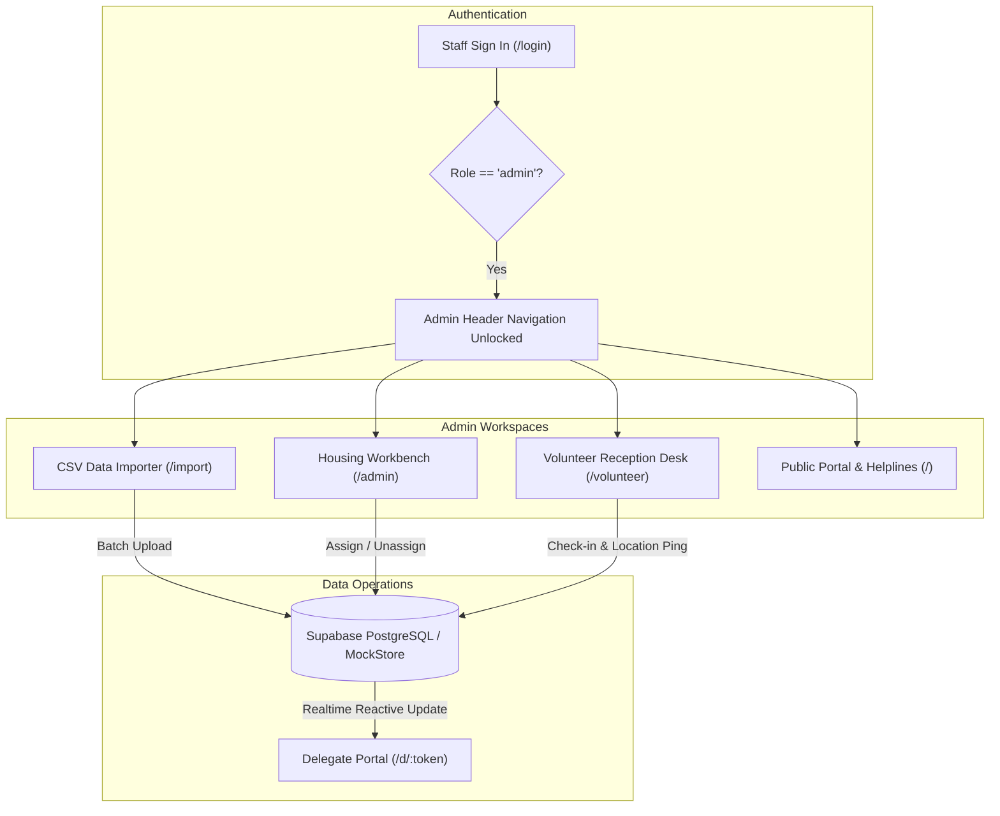
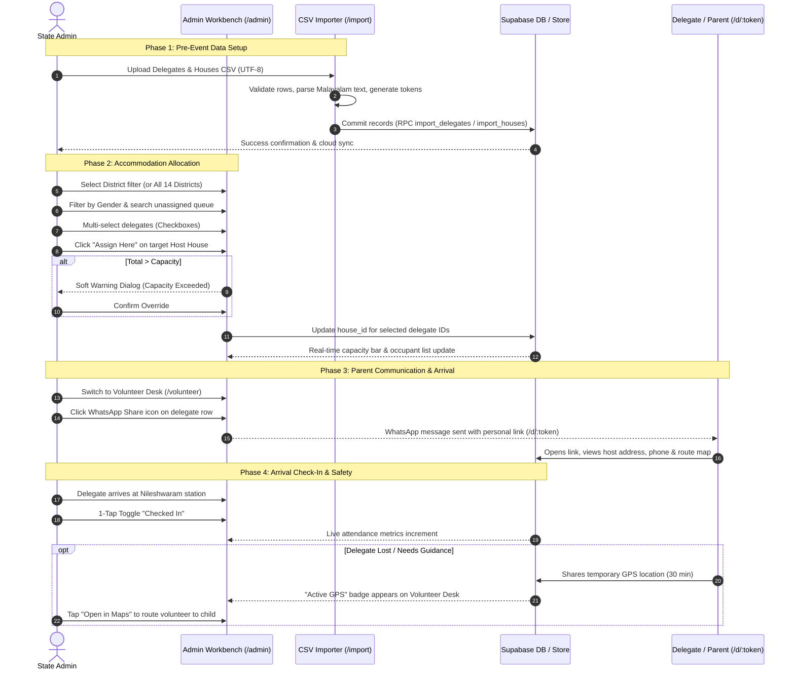

# Balasangham State Conference – Admin Features & User Flow
### ബാലസംഘം സംസ്ഥാന സമ്മേളനം – അഡ്മിൻ ഗൈഡ്

**Event:** 8th Balasangham State Conference (*നീലേശ്വരം, പാലായി, കാസർഗോഡ്*)  
**Dates:** November 27, 28, 29, 2026  
**Role:** **State Admin (Superadmin / സംസ്ഥാന അഡ്മിൻ)**  
**Target:** 500–700 Child Delegates (Aged 10–14), Coordinators, Host Homes & Volunteers  
**Scope:** Full Statewide Cross-District Authority, Accommodation Allocation, UTF-8 CSV Data Import, Check-in Attendance Oversight & Child Safety Controls.

---

## 1. Overview of the Admin Role

In the Balasangham State Conference Accommodation & Stay Tracker, the **State Admin** represents the apex administrative authority (State Reception & Accommodation Committee). While District Coordinators are restricted to their specific home district and Volunteers are scoped strictly to their assigned child delegates, the **State Admin** holds complete cross-district governance, write privileges, and data management rights across all 14 Kerala districts.

### Role Permission Matrix

| Capability | State Admin | District Coordinator | Helpdesk Volunteer | Delegate / Parent |
| :--- | :---: | :---: | :---: | :---: |
| **All 14 Districts Visibility** | **Full (Statewide)** | Single District Only | Assigned Units | Own Stay Only |
| **CSV Data Importer (`/import`)** | **Yes** | No | No | No |
| **Assign / Reallocate Houses** | **Yes** | No (Read-Only) | No | No |
| **Override House Capacity** | **Yes (Soft Warning)** | No | No | No |
| **Arrival Check-In Toggle** | **Yes** | Own District Only | Assigned Delegates | No |
| **View Host & Emergency Contacts** | **All Houses & Parents** | Own District | Assigned Delegates | Own Host & Volunteer |
| **Live GPS Location Pings** | **All Active (30m TTL)** | Own District | Assigned Delegates | Self-Share Only |
| **Database Sync & Purge** | **Yes** | No | No | No |

---

## 2. Core Admin Features & Workspaces

### 1. Authentication & Role Recognition (`/login`)
- **Direct Authentication:** Secure sign-in using email and password powered by Supabase Auth (or interactive local mock storage fallback).
- **Default Test Account:** `admin@balasangham.in` / `admin123`.
- **Dynamic Role Navigation:** Upon signing in as Admin, the top navigation automatically unlocks:
  - **Admin Workbench** (`/admin`)
  - **Volunteer Desk** (`/volunteer`)
  - **CSV Data Import** (`/import`)
- **Role Badge:** Top header displays the authenticated session status: `സംസ്ഥാന അഡ്മിൻ (State Admin)` with an active green pulse indicator.

---

### 2. Housing Allocation & Control Workbench (`/admin`)

The Admin Workbench is a high-speed, two-pane operational center designed for allocating hundreds of delegates into local host houses in Nileshwaram and Palayi.

#### A. Statewide Control Header & District Switcher
- **14-District Selector:** Unlike District Coordinators whose district is locked, Admin has an active dropdown menu allowing instant switching between:
  - `All Districts (14 ജില്ലകൾ)` — statewide aggregate view.
  - Any single district (*e.g., Kannur, Kasaragod, Malappuram, Thiruvananthapuram, Kozhikode*).
- **Bilingual Interface:** Instant Malayalam (official **Anek Malayalam 800 Bold**) / English switcher.

#### B. Live Metric Cards
Real-time summary counters dynamically updated upon every allocation or status toggle:
1. **Total Registered Delegates:** Aggregate count across all districts or filtered district.
2. **Accommodated Count:** Number of delegates currently assigned to a home + percentage completion progress indicator.
3. **Checked-In (ഹാജർ നില):** Real-time tally of child delegates who have reached the venue/station.
4. **Pending Arrival (വഴിയിലാണ്):** Delegates currently en route.

#### C. Left Pane: Unassigned Queue (`/admin`)
- Lists all delegates who currently do not have a room or host house assigned (`house_id === null`).
- **Real-Time Filters:**
  - **Search:** Instant substring filter across delegate names and phone numbers.
  - **Gender Filter:** 1-tap toggles for `All`, `Boys (ആൺകുട്ടികൾ)`, and `Girls (പെൺകുട്ടികൾ)`.
- **Multi-Select Batch Allocation:** Checkbox selection allowing the Admin to choose 1, 2, 4, or more delegates simultaneously for bulk assignment.
- **Delegate Meta Badges:** Shows district name, gender pill (Pink/Blue), phone number, and unit.

#### D. Right Pane: Host Houses & Capacity Matrix (`/admin`)
- Displays all registered host residences in Nileshwaram with host names, phone numbers, addresses, and special notes.
- **Capacity Progress Bar:**
  - Visual status bar showing occupants vs. maximum capacity (e.g., `3 / 4 persons`).
  - Color-coded badges: Green for `X slots free`, Amber for `Full (കപ്പാസിറ്റി പൂർത്തിയായി)`.
- **Gender Restriction Indicators:** Flags houses designated as `Girls Only (പെൺകുട്ടികൾക്ക് മാത്രം)` or `Boys Only (ആൺകുട്ടികൾക്ക് മാത്രം)`.
- **Bulk "Assign Here" Button:** Allots all currently selected delegates from the left pane into the target house with one tap.
- **Soft Over-Capacity Guard (FR-ASN-3):** If assigning exceeds the house's stated capacity, a confirmation modal alerts the Admin:
  > *"Warning: This house capacity is 4. Total will become 5. Do you wish to continue?"*  
  The Admin can confirm to deliberately override or cancel without saving.
- **Current Occupants Management:**
  - Shows an inline pill list of every child staying in that house.
  - **1-Click Check-in Toggle:** Tap the check circle next to an occupant's name to toggle arrival status.
  - **1-Click Unassign Button (`X`):** Immediately removes a delegate from the house and places them back into the unassigned queue.

---

### 3. Bulk CSV Data Importer (`/import` - Admin Exclusive)

To handle large delegate and housing datasets efficiently, the CSV Importer provides pre-validation, Unicode parsing, and database synchronisation.

- **Two Import Modules:**
  1. **Delegates CSV:** Full name, phone, district, gender, emergency contact person, emergency phone, and notes.
  2. **Houses CSV:** House name, address, Google Maps coordinate URL, host name, host phone, capacity, gender restriction, and notes.
- **Malayalam UTF-8 & BOM Support:** Correctly ingests Malayalam Unicode characters exported from Excel or Google Sheets without font distortion.
- **Automatic Token Generation:** Automatically creates a unique, unguessable URL token for each child (e.g., `kannur-arjun-412` or `del-9x8a21`) enabling frictionless parent access without passwords (`/d/:token`).
- **Pre-Commit Validation:** Displays real-time error notifications (missing mandatory names, invalid phone numbers, unrecognised districts) before writing to the database.
- **Dual Cloud & Local Sync:**
  - **Sync Local to Cloud (`Supabase`):** Pushes browser-cached records into the Supabase PostgreSQL database in single-transaction RPC batches.
  - **Clear Local Cache:** Wipes stale device storage and re-fetches the latest live records from the server.

---

### 4. Volunteer Helpdesk & Reception Operations (`/volunteer`)

The Admin has full supervisory control over the check-in reception desk:
- **Instant Lookup:** Search delegates by name, registration token, or phone number.
- **Status Filter:** View `All`, `Pending`, `Checked In`, or `With Live Location`.
- **1-Tap Attendance Check-In:** Instantly toggle delegate arrival state with floating toast notifications (`അർജുൻ കെ. - ഹാജർ രേഖപ്പെടുത്തി!`).
- **1-Click WhatsApp Dispatch (`wa.me`):** Pre-formats a WhatsApp message in Malayalam or English containing the child's direct stay link (`/d/:token`) to send to parents with one tap.
- **Host Directory View:** Switch to the "Houses" tab to view capacity utilisation, direct-dial host phone links (`tel:`), and occupant lists.
- **Live GPS Emergency Tracking:** 
  - Polls active location pings submitted by delegates via their mobile browsers.
  - Enforces a strict 30-minute expiration window for child safety.
  - Provides a 1-tap **"Open in Google Maps"** navigation shortcut to locate lost delegates.

---

## 3. Visual Architecture & Navigation

---

## 4. End-to-End User Flow for Admin

---

## 5. Step-by-Step Walkthrough of the Admin Workflow

### Phase 1: Onboarding & CSV Ingestion (Pre-Conference)
1. **Log In:** Navigate to `/login` and enter admin credentials (`admin@balasangham.in`).
2. **Access Importer:** Click **"Import CSV"** (`/import`) in the header navigation.
3. **Upload Host Houses:**
   - Select the **Houses** tab.
   - Upload the local houses CSV with columns: `name`, `address`, `map_url`, `host_name`, `host_phone`, `capacity`, `gender_restriction`.
   - Review the pre-import table preview.
   - Click **"Commit Houses to Database"**.
4. **Upload Delegates:**
   - Select the **Delegates** tab.
   - Upload the delegates CSV containing names in Malayalam or English, districts, gender, and guardian contact details.
   - Verify that all rows have auto-generated random tokens.
   - Click **"Commit Delegates to Database"**.
5. **Sync Cloud Storage:** If using Supabase, tap **"Sync Local to Cloud"** to ensure data redundancy.

---

### Phase 2: Housing Allocation Matrix (Day -1 & Day 1)
1. **Open Workbench:** Navigate to `/admin`.
2. **Select Target District:** Use the top district selector to focus on incoming cohorts (*e.g., select "Kannur" to allocate the Kannur contingent*).
3. **Filter by Gender:** Click **"Boys"** or **"Girls"** to match delegates with house policies.
4. **Select Delegates:** Check the boxes next to the delegates you wish to group together.
5. **Choose House:** Locate a house with sufficient free capacity in the right pane.
6. **Assign:** Tap **"Assign Here"**.
   - If capacity is sufficient: Instant allocation with an emerald success notification.
   - If over capacity: Confirm the soft warning dialog if you intentionally wish to add an extra occupant.
7. **Reallocate if Needed:** If travel plans change, locate the child under the house card and click the **`X`** unassign button to immediately return them to the queue.

---

### Phase 3: Reception Desk & Arrival Monitoring (Conference Days)
1. **Open Volunteer Desk:** Navigate to `/volunteer`.
2. **Search by Phone or Name:** As trains arrive at Nileshwaram Railway Station, search for arriving children or their accompanying coordinators.
3. **Mark Attendance:** Tap the checkmark icon next to the delegate's record. The status updates to `Checked In`, timestamping the arrival.
4. **Dispatch Stay Links:** For parents who do not have their link handy, tap the green **WhatsApp** icon to launch a pre-populated message with their child's `/d/:token` link.
5. **Emergency GPS Assistance:** If a delegate is stranded or separated, instruct them to tap **"Share Location"** on their mobile portal. Their record on the Admin Volunteer Desk will highlight in green with an **"Open in Google Maps"** navigation button.

---

### Phase 4: Conference Conclusion & Child Data Privacy (Post-Event)
1. **Final Audit & Export:** Run a final export of check-in tallies and stay records for official Balasangham State Committee archives.
2. **Purge Runbook:** In accordance with child privacy policies (Section 9 of the Product Spec), the Admin can trigger a complete database wipe (`TRUNCATE` delegates, location pings, and emergency logs) to ensure no child personal contact data remains online.

---

## 6. Summary of Admin Best Practices

- **Batch Operations:** Always filter by gender before multi-selecting unassigned delegates to prevent accidentally grouping mixed-gender cohorts into gender-restricted host homes.
- **Over-Capacity Policy:** The system allows soft over-capacity overrides to account for emergency accommodation scenarios (*e.g., extra sibling or guardian accompanying a delegate*), but always verify host consent before confirming.
- **Offline Reliability:** In case of intermittent cellular network around Nileshwaram, the Admin Workbench operates seamlessly with local reactive caching, syncing automatically when connectivity is restored.
